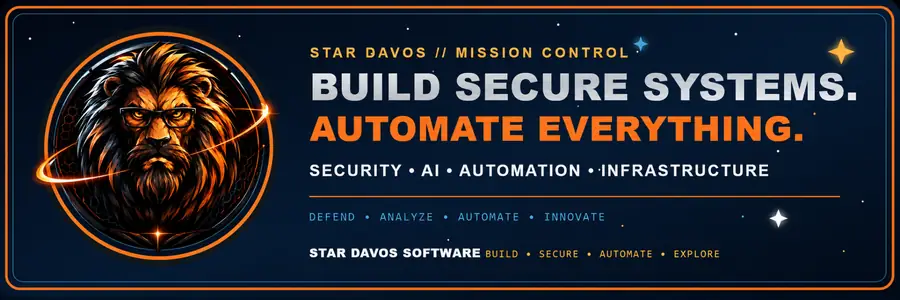

  

<h1 align="center">STAR DAVOS SOFTWARE</h1>

<strong>We build the tools we wish existed.</strong>

Independent, security-minded software development for support operations, practical AI, research, learning, and the repetitive workflows that deserve a better system.

  <a href="https://stardavos.com/">Explore the website and interactive Mission Constellation</a>
  ·
  <a href="https://github.com/StarDavos/OpenAI-Compact-Output">Inspect a public project</a>

---

## What we're about

Star Davos is an independent software studio built around a simple idea: **software should take weight off people, not move it around**.

We turn fragmented workflows into focused tools. We want fewer repetitive steps, clearer evidence, safer defaults, and more room for human judgment. AI is useful when it creates leverage and makes its limits clear. Automation is useful when it keeps the operator in control.

The work spans Microsoft support tooling, developer utilities, creator intelligence, certification learning, decision automation, research systems, and experiments that challenge whether a problem really needs more software.

## Featured missions

| Mission | What we're building | Status |
| --- | --- | --- |
| **Microsoft Admin Workbench** | Local-first Microsoft support investigations with User 360 evidence; a separately enabled, guarded group-membership administration beta remains under testing. | **PRIVATE R&D** · preview |
| **SCORE** | Creator-relative performance analysis, pattern discovery, and evidence-led content experiments—not a virality predictor. | **PRIVATE R&D** · V1 |
| **TRACE** | Civic-source provenance, review workflows, corrections, and relationship mapping, tested with fictional demo data. | **EXPERIMENT** · demo |
| **CTP — Certification Training Platform** | One reusable practice, exam, progress, and readiness engine for versioned certification modules and original reviewed content. | **PRIVATE R&D** · platform generalization |
| **Unriddle** | Capture repeated decisions as explicit rules, then bring only exceptions back to the human. | **PRIVATE R&D** · bootstrap |
| **ASH** | Research and replay lawful opportunity hypotheses against costs, constraints, and later evidence; no autonomous financial execution. | **PRIVATE R&D** · research |
| **Star Davos OSINT** | Public-source evidence collection and correlation that preserves provenance and uncertainty. | **PRIVATE R&D** · foundation |
| **[Compact Code Viewer](https://github.com/StarDavos/OpenAI-Compact-Output)** | A ChatGPT MCP utility for displaying and copying complete technical output, with source-integrity checks. | **PUBLIC PROJECT** |

Private missions are described here, **not presented as open-source releases**. Only projects with genuinely public source link directly to their repositories. Preview features are not production-readiness claims.

## Elsewhere in the workshop

We also maintain private exploratory work in secure AI engineering (OpenAI Sandbox), code-safety analysis, Project Zero systems experiments, the JEV coding harness, and a cross-platform **Security Engineering Lab** for documented Windows/Linux learning. These are research and learning activities, not customer products being advertised as shipped.

## The operating doctrine

> Make it useful. Make it understandable. Protect the human on the other side.

- **Show the work.** Separate evidence from assumptions, and observations from predictions.
- **Keep control.** Least privilege, explicit approval for consequential changes, and a way to recover.
- **Earn the automation.** Start narrow, test the failure paths, then expand authority only when justified.
- **Keep things operable.** A smaller, clear system beats an impressive demo nobody can maintain.
- **Build with care.** Curiosity, discipline, and the desire to leave things better than we found them.

## Where this goes

Our strongest starting point is usually a messy, expensive workflow: switching between too many tools, investigating with missing context, rewriting the same answer, or rechecking a decision the system could explain.

**Bring us the messy workflow.** We want to understand the real cost, find the smallest useful solution, and make it safer and easier to operate.

  <strong>BUILD WITH PURPOSE · SHOW THE WORK · KEEP EVOLVING</strong>

  <a href="https://stardavos.com/">stardavos.com</a> · <a href="https://github.com/StarDavos/OpenAI-Compact-Output">Public source</a>

Portfolio snapshot: October 2026. Project scope and readiness change as work is verified.
